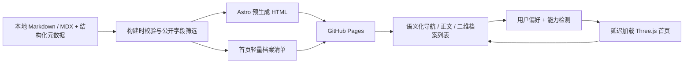
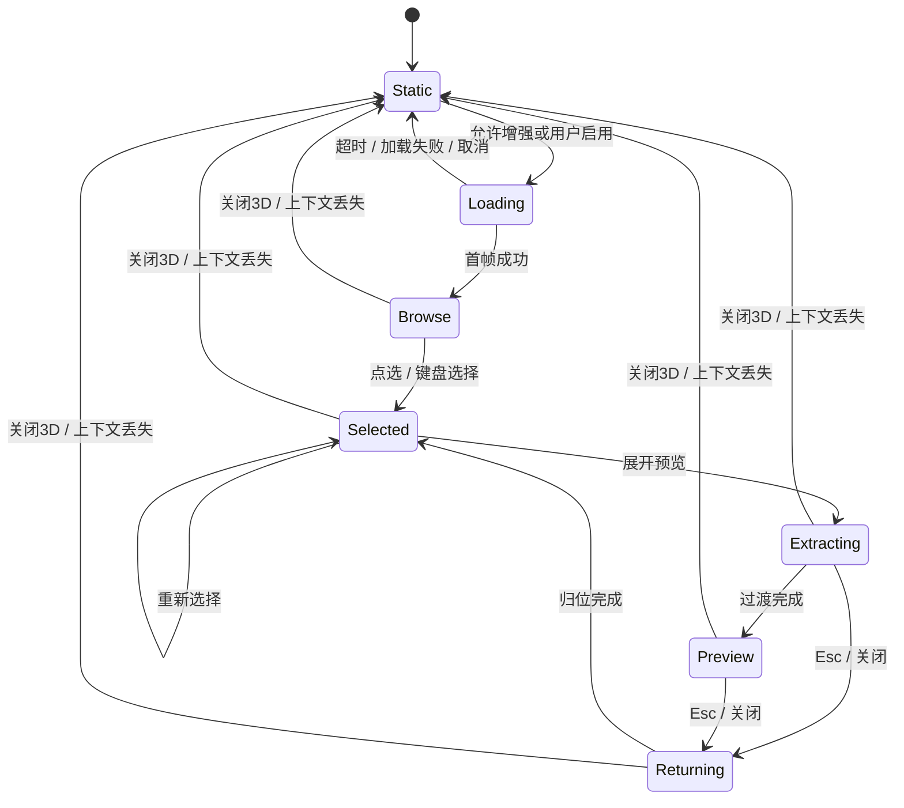

# BIOINFORMATICS ARCHIVE — 技术架构

状态：Phase 3.1 已在 Phase 3 内容之上接入分层档案，2026-10-22 完成后续视觉与阅读布局优化。发布仍未执行。

## 2026-10-22 当前实现（优先于下方历史记录）

- 导航和波浪更新：`ArchiveTerminal.astro` + `navigation-layout.css` 提供透明右侧摘要及底部两个导航轴，统一 Logo 下方返回、3D / 简洁双段切换。`bootstrap.ts` 根据 manifest 提供总数、下一目标和 Raycaster 悬停标题；`wheel-navigation.ts` 归一化滚轮单位并限制触控板连续触发。移除常驻 Skip Intro / 静态页面入口，保留无 JS 目录和正文读取失败恢复链接。

- `archive-waves.ts` 改编上游 MIT 待机/切换波公式：8s 与 13s 小幅叠加波；交互后 2.5s 渐入待机；切换波每秒推进 8 个行单位、3.2s 过期、最多 6 个、幅度限制 ±0.6。`MatrixField.ts` 应用于实例与活动档案，阅读时淡出。仅可见且正常动效的矩阵持续渲染；reduced-motion、隐藏、离屏、Contact、简洁模式分别禁用/暂停/释放。
- `CassetteKit.ts` 定义共享圆角金属壳、嵌板、边轨、螺钉、磨砂盖和原创文字纹理。首页双文件夹增加内页层叠；活动档案增加三个立体登记模块。没有引入外部模型 / HDR / 纹理资产。
- `ArchiveScene.ts` 统一管理 renderer、相机与照明；Three.js RoomEnvironment 经 PMREM 生成小型环境贴图，生成器立即清理。`FolderField.ts` 与 `MatrixField.ts` 交换选中模型位置 / 四元数，切换时继续同一相机运动，避免模型和视野跳变。
- `motion.ts` 使用解析临界阻尼弹簧，改向保留速度；相机方向、目标、距离与视野高度分别平滑更新。文件夹打开等待 720ms，档案抽取等待 900ms 后呈现正文，右侧面板再进行 440ms 克制揭示；轻量 / reduced-motion 跳过等待。
- `archive-model.ts` 的 `projectColumns()` 展平所有作品集的项目列。左右连续循环 A1–A4、T1–T2，上下仅切换当前项目栏目；每个项目保留独立行记忆。打开阅读器后仍可通过场景导航或移动端明确控件切换项目 / 栏目。原有内容层级与分享 hash 不变。
- 阵列统一使用 24 个真实栏目数据，切换作品集不再销毁 / 重建场景。桌面 9×36 / 紧凑 5×24 物理实例池、14 组共享 InstancedMesh；重复视觉槽位不代表新增项目或成果。远处实例简化倒角细分，当前活动卡匣独立保留完整细节，返回中的旧卡匣平滑归位。
- `reader.ts` 继续从真实静态详情抽取栏目，改为非模态 section。桌面模型在左侧、正文在右侧，窄屏模型在上、正文在下。图片 / 外部链接、取消过时 fetch、六页缓存保持原行为；不重复维护正文。
- 阅读器不再阻止模型动画，模型和相机稳定后自动停止 RAF。Contact / 页面隐藏 / 离屏仍暂停，轻量或离页释放资源。3D 首页为全视口布局，隐藏重复文字目录；轻量 / 无 JS 的真实链接树保留。
- 实现、测试和截图见 [ARCHIVE_POLISH_REPORT.md](ARCHIVE_POLISH_REPORT.md)。下列 360/520ms、原生 dialog、8 组实例和阅读即暂停的说明仅代表优化前版本。

## Phase 3.1 初次实现（历史记录）

- 首页只有 Academic / Technical 两个文件夹。Academic 4 列 × 4 栏目，Technical 2 列 × 4 栏目；同一个 `ArchiveScene.configure()` 切换布局，保留 renderer、相机、照明、共享几何和背景网格，仅释放并重建当前模型、材质和标签。
- `src/lib/archive-manifest.ts` 在构建期读取既有公开内容集合，生成 Portfolio → Project → Section → Content 导航。Project.id 是既有 translationKey；section.contentIds 映射现有详情页的 section ID，href 是真实静态页面及锚点。无新增服务器端接口。
- `archive-model.ts` 是纯状态转换；HOME / PORTFOLIO_MATRIX / DOCUMENT_VIEWER 是互斥基础状态，CONTACT_PANEL 作为保存基础状态的覆盖层。列索引与以 portfolio/project 为键的行记忆分开。数组长度取自数据，不硬编码两轴取模。
- `bootstrap.ts` 唯一协调输入、URL、DOM 与场景。双击 / Enter / 明确按钮触发文件夹 360ms、档案 520ms 打开过渡，期间拒绝重复打开及选择；Back、Contact、历史导航可取消计时器。减少动态效果或轻量模式直接进入。选择用 replaceState，进入 / 打开 / 返回用 pushState；popstate / hashchange 解析并恢复位置，非法 ID 回到 HOME。
- URL 示例：`/#archive/academic/black-porgy-sex-reversal/workflow/read`。去掉 `/read` 是矩阵状态；`#archive` 是首页；末尾 `/contact` 是联系面板。英中共享相同 ID，语言链接保留 hash；真实静态详情仍为分享 / SEO 的主要链接。
- `reader.ts` 用 AbortController 按需 fetch 同源已构建详情，提取所选栏目和原有证据说明；不引入详情脚本，不复制维护正文。最多缓存六个页面，退出或新请求取消过时读取。失败时保留静态链接。原生 dialog 提供模态焦点和 Esc；图片原图、DOI 和外部资料在新标签打开。
- 资源只保留当前布局：首页 2 文件夹；矩阵使用 `MatrixField.ts` 的有限循环实例池，桌面 9×36、紧凑模式 5×24 个物理槽位，映射学术 16 / 技术 8 个逻辑栏目。重复槽位仅用于无缝视觉循环，不代表额外成果。8 组 InstancedMesh 共享几何与材质，当前档案由独立活动组抬起；`matrix-layout.ts` 保持物理方向、逻辑 ID 和邻近循环副本一致。
- 第二级采用全视口构图：卡匣 5×3.7×0.24、列距 5.2、纵深行距 0.62、默认长焦距离 140 / 视野高度 7.33。桌面使用 1536px PCF 阴影，粗指针关闭阴影；无 GLB / HDR / 后处理。进入矩阵时隐藏首页网格并 inert 背景正文，退出恢复。稳态、离屏、隐藏和阅读器 / Contact 打开时停止绘制，离页及轻量模式释放资源。
- 循环映射、肩部曲线和相机构图参考 / 改编固定上游提交的 MIT 代码，完整许可和文件对应关系见 `THIRD_PARTY_NOTICES.md`。不复用游戏模型或素材。
- 首页 Header 仅 Contact 与语言切换；内容页保留完整导航。服务器生成的两级 HTML 目录覆盖全部项目栏目，无 JS / 无 WebGL 时仍能访问。旧 Publications / About / Contact / CV 路由未删除。

下文 Phase 3、Phase 2 的五入口结构和未来大规模阵列方案为历史记录。验证与文件清单见 [PHASE3_1_ARCHIVE_REFACTOR_REPORT.md](PHASE3_1_ARCHIVE_REFACTOR_REPORT.md)。

当前主导航 Home / Academic / Technical / About / Contact。/academic/ 按 A1 / A2 / A3 分组四项研究，/technical/ 展示 T1 / T2；详情保留 /research/<slug>/ 与 /projects/<slug>/。旧索引和模板 URL 继续有效，中文使用 /zh/。

新增 components/portfolio 下的总览、科研详情、技术详情与图像组件；数据继续来自独立 Astro 内容集合。论文逻辑引用在构建时解析，图像来源及尺寸由 schema 校验。研究提纲和已核验成果显式分离。

首页仍为独立路由和动态 Three.js 导入；本轮未改写 src/scene。场景清单改为 Academic / Technical / Publications / Profile / Contact，保留内部 ID 和清理策略。详见 [PHASE3_CONTENT_REPORT.md](PHASE3_CONTENT_REPORT.md)。下文 Phase 2 入口名称及扩展方案是历史记录。

当前首页使用独立 `src/pages/index.astro` 与 `src/pages/zh/index.astro`，其他路由由 `src/pages/[...path].astro` 枚举生成。首页 DOM 控制器动态导入 `ArchiveScene.ts`，静态内容页不引用该控制器。软件项目公开路径为 `/projects/`，内容集合名仍为 `software`。当前支持 Markdown。实施记录见 [PHASE_1_REPORT.md](PHASE_1_REPORT.md) 与 [PHASE_2_REPORT.md](PHASE_2_REPORT.md)。

Phase 2 采用五类固定导航清单 `src/data/archive.ts`，暂不将真实成果映射进场景：Research、Publications、Software、Profile、Contact。五个可交互 Group 共用几何，十个背板由一个 InstancedMesh 绘制，总计十五片；无需活动对象复制 / 归位池。DOM 摘要与真实 HTML 链接来自同一清单。下文更多实体、活动 Mesh 替换、自动质量监测等属于扩展方案，不代表本阶段已实现。

资源由 LIFO disposal scope 统一释放，涵盖初始化失败；按需 RAF 在稳态停下，IntersectionObserver / visibilitychange 暂停绘制，pagehide 清理，BFCache pageshow 可重建。异步导入有 8 秒超时与 request ticket；不能取消浏览器已经发出的 import 请求，但取消后不创建场景。当前轻量模式释放全部 WebGL 资源；小屏、粗指针、reduced-motion 和 save-data 默认轻量。没有自动反复切换画质的逻辑。

本站服务博士申请与生物信息学 / AI 研发求职，部署于 <https://azure179.github.io>。阅读科研证据、理解个人贡献、查看代码和下载 CV 是主要任务；3D 档案是首页的导航与展示层。

关联文档：[视觉与参考研究](DESIGN_SPEC.md) · [实施计划](IMPLEMENTATION_PLAN.md) · [内容计划](CONTENT_PLAN.md) · [开发约束](../AGENTS.md)。

## 1. 范围与决策

| 项目 | 决策 | 原因 |
| --- | --- | --- |
| 页面生成 | Astro，`output: "static"` | 每个详情地址拥有真实 HTML，适合搜索、分享和 GitHub Pages |
| 类型 | TypeScript strict | 内容字段、路由、场景状态建立明确契约 |
| 样式 | Tailwind CSS 4 + CSS 变量 | 工具类组织布局，设计令牌统一颜色、间距、动效 |
| 3D | 原生 Three.js，首页动态导入 | 不为单个场景引入 React 或额外渲染框架 |
| 内容 | Astro 构建时 Content Collections + Markdown；必要时 MDX | 正文独立维护，类型校验，构建时生成页面 |
| 语言 | 英文根路径；简体中文 `/zh/` | URL 可直接分享，默认英文，无需客户端切换整页文案 |
| 导航 | 浏览器原生多页导航 | 支持新标签打开、历史记录、刷新和无 JavaScript 使用 |
| 状态 | 轻量 TS 控制器，组件作用域事件 | 不引入全局状态管理依赖 |
| 服务 | 无服务器、数据库、登录、付费 API | 联系使用经确认的邮箱 / 外部专业主页链接 |
| 素材 | 原创程序几何、自制图表、明确许可的资产 | 不导入上游原作相关模型、图像、音频或标志 |
| 首版不做 | PWA、音效、360° 拆解、站内全文搜索、主题切换、长片头 | 限制维护成本和首屏负担 |

Astro 的构建时集合使用 `src/content.config.ts`，通过 loader 与 schema 管理本地文档；本项目不使用 live collections。Tailwind 4 采用官方 Vite 插件路线，不沿用旧版 `@astrojs/tailwind` 集成。[Content Collections](https://docs.astro.build/en/guides/content-collections/)、[Astro 样式文档](https://docs.astro.build/en/guides/styling/)。

正式初始化时选择相互兼容的稳定版 Astro、Three.js、TypeScript、Tailwind 与 Astro 集成，记录准确版本、Node engines 和锁文件；不把参考项目的依赖版本当作本站约束，也不在本文猜定未来版本。包管理器选 npm，提交 `package-lock.json`，CI 使用 `npm ci`。

## 2. 系统结构



内容层不知道场景坐标；场景层只接收公开的标题、摘要、分类、稳定 ID 与 URL。DOM 和场景从同一份内容清单派生，避免三维中的项目与详情页失配。

### 长期建议目录（当前实际目录以 README 与实施记录为准）

```text
src/
  content.config.ts
  content/
    research/<translationKey>/<locale>.md
    software/<translationKey>/<locale>.md
    publications/<translationKey>/<locale>.md
  data/
    profile.json
    navigation.ts
    assets.json
  i18n/
    en.ts
    zh.ts
    routes.ts
  lib/
    content.ts
    routes.ts
    archive-manifest.ts
  layouts/
    BaseLayout.astro
    ContentLayout.astro
    ArchiveLayout.astro
  components/
    site/
    archive/
    content/
  scene/
    bootstrap.ts
    ArchiveScene.ts
    ArchiveController.ts
    ArchiveInstances.ts
    ArchiveSelection.ts
    CameraRig.ts
    InputController.ts
    Motion.ts
    QualityController.ts
    ResourceTracker.ts
    types.ts
  styles/
    global.css
    tokens.css
    prose.css
  pages/
    index.astro
    research/{index.astro,[slug].astro}
    projects/{index.astro,[slug].astro}
    publications/{index.astro,[slug].astro}
    about.astro
    cv.astro
    contact.astro
    credits.astro
    zh/                         # 对应中文入口，复用布局与页面内容组件
    404.astro
public/
  documents/                    # 仅经确认可公开的 CV / 补充材料
  licenses/                     # 实际随站分发的第三方完整许可证
  images/                       # 不需构建优化的少量静态资源
tests/
  unit/
  e2e/
scripts/
  check-content.mjs
  check-links.mjs
  check-budgets.mjs
docs/
.github/workflows/
```

图像可优先放在 `src/assets/` 以便 Astro 构建优化；`public/` 文件直接复制到产物，不可放草稿、私有证据或未授权文件。

## 3. 路由与访问方式

| 英文 URL | 中文 URL | 页面用途 |
| --- | --- | --- |
| `/` | `/zh/` | 可增强的档案首页 |
| `/research/` | `/zh/research/` | 科研方向和已公开项目索引 |
| `/research/<slug>/` | `/zh/research/<slug>/` | 问题、方法、贡献、结果、限制、复现材料 |
| `/projects/` | `/zh/projects/` | 工具和 AI / 生信工程项目索引 |
| `/projects/<slug>/` | `/zh/projects/<slug>/` | 工程问题、架构、测试、性能证据、使用方式 |
| `/publications/` | `/zh/publications/` | 已核验的论文 / 预印本列表 |
| `/publications/<slug>/` | `/zh/publications/<slug>/` | 有足够内容时生成的论文说明页 |
| `/about/` | `/zh/about/` | 真实背景、研究兴趣与工作方式 |
| `/cv/` | `/zh/cv/` | 可访问的 HTML 简历及已提供的 PDF 下载 |
| `/contact/` | `/zh/contact/` | 经确认的联系方式 |
| `/credits/` | `/zh/credits/` | 代码与素材来源、许可证 |
| `/404.html` | 同一个双语 404 页面 | 普通站点导航与返回首页 |

- 索引页一直可访问。暂无经确认论文时，说明“Publications will be added after verification”，不造示例论文。
- 明细页仅为 `draft: false`、`verified: true` 且公开的内容生成，`getStaticPaths()` 直接枚举有效条目。
- `slug` 使用稳定小写 ASCII 连字符，跨语言一致；显示标题允许中英文不同。
- `trailingSlash: "always"`，HTML 输出按目录组织；测试直接访问深层路径及浏览器刷新。
- 不采用 hash 路由，也不采用把所有 404 重定向到首页的 SPA 补丁。
- 首页恢复选择可使用 `?archive=<stable-id>`；这是可忽略的展示状态，不能成为唯一详情地址。不存在的 ID 回到默认分类，不抛错误。
- 外部代码、DOI、项目演示均为真实链接；不在访问时调用 GitHub / 学术 API。

## 4. 组件职责

| 组件 / 模块 | 职责 | 客户端脚本 |
| --- | --- | --- |
| `BaseLayout` | lang、标题、SEO、跳过链接、页眉页脚 | 无 Three.js |
| `SiteHeader` / `LanguageSwitch` | 全站导航、对应语言 URL | 语言切换可纯链接 |
| `ContentLayout` / `TableOfContents` | 正文、元信息、目录、打印 | 目录默认锚点 |
| `ProjectCard` / `PublicationList` | 结构化摘要、状态、公开证据链接 | 默认无 |
| `ArchiveShell` | 预留场景空间、基础介绍、加载与失败提示 | 小型加载器 |
| `ArchiveIndex` | 所有分类 / 条目的语义化列表和详情链接 | 增强选择可选 |
| `ArchiveControls` | 前后选择、分类切换、显示模式 | 不直接操作 Three 对象 |
| `ArchivePreview` | 当前项目摘要、个人贡献、阅读链接 | 内容由 manifest 更新 |
| `SceneToggle` | 2D / 3D 切换及偏好保存 | 存储失败可忽略 |
| `ArchiveController` | 唯一选择状态、动效目标、DOM 与 3D 通信 | 不生成正文 HTML |
| `ArchiveScene` | renderer、scene、循环、对象集合 | 仅首页导入 |
| `ArchiveInstances` | 实例几何、位置和 instanceId 映射 | 无路由逻辑 |
| `CameraRig` / `Motion` | 取景、时间驱动插值、可中断过渡 | 不读 DOM 文案 |
| `QualityController` | 分辨率、实例上限和性能降级 | 不影响文字尺寸 |
| `ResourceTracker` | 释放几何、材质、纹理、监听、RAF | 可重复 dispose |

Astro 组件输出 HTML，使用组件脚本及 `import()` 加载原生 TS 场景；不对 `.astro` 组件误用框架专用的 `client:only` / `client:load` 水合方式。全站 layout 禁止导入 `three`，确保详情页不意外进入 3D 依赖图。

## 5. 首页场景与状态契约

### 5.1 场景构成

五个稳定分类入口：Research、Software、Publications、About、CV。每列首张是分类入口，后续只有经过核验的真实条目。空分类仍可打开索引页，背景装饰片不计入成果数。

首版使用有限阵列，桌面总可见实体目标不超过 60，移动端主动启用后不超过 18；包括一个抽取对象及最多两个正在归位的副本。相同外壳以 `InstancedMesh` 绘制，活动卡片用独立 Mesh / Group，切换时隐藏原实例，归位后恢复，避免重叠和闪烁。不把上游无限循环列或其 40 份演示档案搬入站点。

桌面初始窗口最多五列、每列十个槽位；移动端最多三个可见列、每列五个槽位，其他分类通过 DOM 按钮切换。内容超出窗口时仅渲染选中位置附近的有限切片，DOM 索引仍列出全部已发布条目。首版导航到首尾时禁用对应上一项 / 下一项按钮，不周期复制成果；无需为内容增长无界增加 Mesh。

每张卡片采用原创薄板、索引边签和抽象点阵。摘要与按钮在 HTML 中；Canvas 不承载唯一文字信息。具体布局、材质、尺寸及动画见 [DESIGN_SPEC.md](DESIGN_SPEC.md)。

### 5.2 状态



完整阅读始终由普通 `<a href>` 前往静态页面；展开预览是独立按钮，镜头动画不拦截链接。任何状态都允许从页眉、索引或预览的阅读链接离开。

- `hoveredId` 为临时提示，不能改变 `selectedId`。
- `selectedId`、`categoryId` 与目标变换集中在控制器；渲染层保存实际变换和速度。
- 快速输入只接续到最新目标；禁止排队播放全部旧动画。
- 归位副本达到两个的上限后，优先将最早副本直接归位并恢复实例，再接收新目标，不累积对象。
- 抽取只改变卡片高度，相机负责重新取景；首版不提供任意旋转，降低穿插复杂度。
- 展开状态中选择其他条目：先取消旧过渡并归位，再切换到新的选中状态；不自动打开新详情。
- 输入只绑定首页档案区域；表单、正文阅读、全站快捷键不被劫持。移动端不捕获全页纵向滚动。
- 自定义事件传递 `{ id, source }` 等数据；不把任意 HTML 字符串通过事件注入页面。

### 5.3 加载与资源生命周期

1. 第一份 HTML 已含标题、导航、介绍、分类、真实条目链接和二维展示。
2. `matchMedia`、用户偏好与输入能力决定是否增强。桌面正常动效可在首屏内容绘制后延迟加载；粗指针、窄屏、节流网络提示或减少动态效果默认保持 2D。
3. 网络节省提示仅为可选优化，不依赖各浏览器均支持该 API。核心降级由用户控制和实际创建结果决定。
4. 动态导入 Three.js，尝试创建 WebGL2 renderer；成功绘制首帧后再切换展示。初始化超过 8 秒则保留 2D 并提供手动重试。
5. 每次加载持有 generation token；用户关闭、导航或再次发起时旧结果失效并释放资源，迟到结果不能覆盖新状态。
6. 视口变化由 `ResizeObserver` 调整投影与缓冲区，保留选择。隐藏页面 / 场景离屏时暂停 RAF，恢复时重置时间基准，不累积巨大 `dt`。
7. 稳态停止 RAF，仅输入、resize、材质加载或动效唤醒；默认没有永久呼吸动画。
8. `webglcontextlost` 立即显示可用的二维内容并停止循环；恢复或重试需重新初始化，一次失败后不无限自动重建。
9. 关闭时释放独占 GPU 资源、renderer、观察器、事件和计时器；共享几何按所有权只释放一次。`pagehide` 清理；BFCache `pageshow` 恢复为可用静态状态并按偏好重新增强。

## 6. 内容模型与国际化

完整字段与核验规则在 [CONTENT_PLAN.md](CONTENT_PLAN.md)。集合划分为 research、software、publications；profile 单独存储并校验。

公开清单只保留：

```ts
type ArchiveItem = {
  id: string;                    // 稳定、跨语言一致
  category: "research" | "software" | "publications" | "about" | "cv";
  kind: "category" | "entry";
  title: string;
  summary: string;
  href: string;                  // 由统一路由函数生成
  locale: "en" | "zh";
  contentLanguage: "en" | "zh";
  tags: string[];
  featuredOrder?: number;
};
```

- 原始正文、未公开证据、作者私人信息不进入清单或客户端 JSON。
- `translationKey + locale` 唯一；schema 校验后由同一函数生成 HTML 路由、索引、场景摘要及 sitemap。
- Astro i18n：`defaultLocale: "en"`、`locales: ["en", "zh"]`、`prefixDefaultLocale: false`。此配置与实际 `src/pages` 路径配合，不能自动替代中文文件或翻译。[Astro i18n](https://docs.astro.build/en/guides/internationalization/)。
- HTML 语言为 `en` / `zh-CN`；UI 字典要求键齐全，CI 检查遗漏。
- 中文翻译缺失时，不制造 `/zh/...` 假译文页；中文索引保留条目并标记“英文内容”，链接到英文详情。语言切换指向该中文分类索引，并说明暂无译文。
- `canonical` 使用实际页面语言的 URL；只有真实译文互设 `hreflang="en"` / `zh-CN`，`x-default` 指向英文版。未翻译内容不宣称存在中文 alternate。
- URL 决定语言，不按浏览器语言强制重定向。首版不必保存语言偏好。
- 日期采用可解析 ISO 数据，按页面 locale 格式化；不把发布日期、研究区间或更新日期混为一谈。

## 7. 性能、可访问性与 SEO

以下为首版验收预算，尚无测量结果：

| 项目 | 目标 / 测量边界 |
| --- | --- |
| 首页基础 JS | gzip ≤ 35 KiB，不含按需 3D chunk |
| 详情页 JS | gzip ≤ 15 KiB；Three.js 请求数必须为 0 |
| 3D JS | 全部延迟加载 chunk 合计 gzip ≤ 220 KiB；超出需分析依赖 |
| 初始基础传输 | HTML、CSS、基础 JS、首屏图片总和 ≤ 350 KiB，3D 与 CV 下载分开统计 |
| 场景首次启用额外传输 | 脚本和场景资源合计 ≤ 700 KiB；首版程序几何无 GLB / HDR |
| 场景渲染 | 桌面 DPR ≤ 1.5 且 ≤ 2.1M 像素；移动 DPR ≤ 1 且 ≤ 0.8M 像素 |
| 场景规模 | 桌面 ≤ 60 实体 / 100k 三角形；移动 ≤ 18 实体 / 30k 三角形 |
| 绘制调用 | 目标桌面 ≤ 30、移动 ≤ 15，按所有实际 passes 计数 |
| 交互帧时间 | 指定桌面测试机 p95 ≤ 20ms；移动主动启用模式 p95 ≤ 33ms |
| 内容体验 | LCP ≤ 2.5s、CLS ≤ 0.1；有真实流量后核验 p75 INP ≤ 200ms |

本地实验室指标用于开发回归，不能冒充真实用户 p75。记录设备、浏览器、网络、CPU 节流、冷 / 热缓存及测量路径；Lighthouse 单个分数不替代 INP 或真机帧时间。

降级顺序：降低像素数 → 减少装饰实例 → 关闭可选阴影 / 透射 → 提供 / 切回二维模式。连续 3 秒交互采样显著超过目标后才降档；只降不自动来回升档，避免抖动。后台和初始化帧不参与判断。

首版背景卡片使用不透明低成本材质，活动片可模拟磨砂高光；不默认使用 SSAO、景深、全屏模糊、HDR 或多层 transmission。共享实例与资源，raycast 最多每 RAF 一次，拾取只覆盖交互实体。

可访问性目标为 WCAG 2.2 AA 的相关要求，需实际测试：

- 站点使用语义化 `header/nav/main/footer`、唯一 H1、清晰标题层级、跳过导航链接。
- Canvas 为 `aria-hidden="true"` 的增强视觉；同一操作由 HTML 按钮和链接提供，不能只靠 ARIA 给画布命名。
- 普通 Tab 顺序可完成所有任务；选择按钮标记 `aria-pressed`，详情链接保留原生 Enter 行为；区域内方向键只在明确聚焦的控件组生效。
- 选择完成后用简短 `aria-live="polite"` 通知，不朗读 hover 或每帧动画。
- 尊重 `prefers-reduced-motion`；保留始终可见的二维 / 三维开关。减少动画模式无镜头飞行、波纹和视差。
- 触控目标至少 44×44 CSS px；可见焦点、对比度、200% 缩放与 320 CSS px 回流均验证。
- 全文可选择、复制、打印。表格可局部横向滚动，正文不得全页横向溢出。
- 页面标题、描述、Open Graph、sitemap、robots 在构建时生成。Person / ScholarlyArticle 结构化数据仅包含真实已核验字段，不填假作者或假成果。

## 8. GitHub Pages 部署设计

这是用户站点仓库 `Azure179.github.io`，不是 `/某项目名/` 下的项目站点。建议配置：

```ts
// 当前配置的关键设置；完整实现见根目录 astro.config.mjs
{
  site: "https://azure179.github.io",
  output: "static",
  trailingSlash: "always",
  build: { format: "directory" },
  i18n: {
    defaultLocale: "en",
    locales: ["en", "zh"],
    routing: { prefixDefaultLocale: false }
  }
}
```

所有动态路由预生成，产物为 `dist/`，不安装服务端 adapter。GitHub Pages 支持静态站点；部署由 Actions 构建与上传产物完成。[GitHub Pages](https://docs.github.com/en/pages/getting-started-with-github-pages/what-is-github-pages)、[Astro 部署指南](https://docs.astro.build/en/guides/deploy/github/)。

后续实施流水线：

1. PR / 手动检查：checkout → 安装锁定 Node 与 npm 依赖 → 类型与内容校验 → 单元测试 → 构建 → 链接 / 预算检查 → 产物端到端检查；PR 不部署。
2. 获得发布授权后启用默认分支 push 或 `workflow_dispatch` 部署；读取实际默认分支，不假定其名称。
3. 构建 job 仅 `contents: read`；部署 job 使用 `pages: write`、`id-token: write`、`github-pages` environment。官方 checkout / setup-node / configure-pages / upload-pages-artifact / deploy-pages Actions 使用实施时核验的版本，优先固定提交 SHA。
4. 上传 `dist/` artifact，再部署该 artifact。通过 concurrency 防止发布竞争，不给外部 PR 部署权限。
5. 仓库 Settings → Pages 的 Source 设为 GitHub Actions。保持用户站点根路径，不添加无意义的 `CNAME`。
6. 验证首页、中文页、真实深层页刷新、404、PDF 链接及 `/_astro/` 资源。回滚为重新部署已知正常提交的构建产物。

Phase 1 已安装依赖并完成本地实现；当前不创建 workflow、不修改 Pages 设置、不 commit、不 push、不发布。普通开发授权不自动覆盖发布授权。

## 9. 风险与处理

| 风险 | 处理 |
| --- | --- |
| 参考源码与说明版本不一致 | 使用固定上游提交，记录源码符号；历史参数单独标记 |
| 3D 变成阅读门槛 | 静态内容先出；普通链接始终可用；动画不延迟跳转 |
| 移动发热或弱 GPU | 默认 2D；显式启用 3D；像素与实例预算；离屏暂停 |
| 原作元素混入代码或资产 | 首版原创几何；复用仅审查后的通用模块；资产逐项登记 |
| 内容不足 | 不虚构，用空状态；开发 fixture 仅在测试，禁止进入生产 |
| 英中内容不同步 | translationKey 与 sourceRevision 检查，陈旧译文阻止发布 |
| 升级破坏 Three.js 内部扩展 | 不采用上游依赖私有渲染方法的深度复用扩展 |
| 联系方式 / CV 未提供 | 隐藏不可用动作，不能放假邮箱或空下载链接 |

## 10. Phase 3.2 内容扩展（2026-10-23）

六项目继续使用既有 Portfolio → Project → Section → Content 和相同详情路由；3D reader 读取静态详情的栏目，不新增平行正文源。`figures.placement` 将媒体分配到对应栏目；`mediaSlots` 保存缺失素材的文字提示。公共 `FigureLightbox` 通过事件委托支持静态页与动态 reader，并保留直接打开图片的 HTML 链接。

科研状态新增 `published-review`，允许有正式论文证据但个人职责尚未完整核查的研究综述；不等于 `verified-study`。`outline` 仅可使用原创 diagram，仍禁止科研结果及论文关联。论文集中维护并按稳定 ID 引用。原创 SVG 使用显式双语资源路径。字段及手动填写示例见 `CONTENT_PLAN.md`、`CONTENT_ASSET_TODO.md`。

# 发布准备更新（2026-10-23）

用户现已授权配置 `.github/workflows/deploy.yml`。main push → npm ci → 类型 / 测试 / 格式 → build → check:site / check:release → Pages artifact → deploy-pages。site 及无 base 配置保持不变；本轮不执行远端发布。

内容展示精简但 Portfolio / Project / Section 稳定 ID 不变。manifest 移除已删除的问题、贡献栏目引用，A4 不引用空 findings。PNG 在构建时由 `figure-dimensions.ts` 读取实际尺寸，支持同名替换；其文件系统代码不会进入浏览器。Research outline 仅放行 diagram 或显式 placeholder，不能据此发布结果。

以下早期阶段的部署禁止说明为历史记录；当前操作流程见 `DEPLOYMENT_GUIDE.md`。
