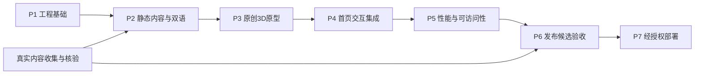

# BIOINFORMATICS ARCHIVE — 分阶段实施计划

2026-10-22 后续优化已实现：统一金属卡匣模型、首页 / 矩阵姿态交接、连续阻尼镜头、旧选中档案平滑归位、非模态右侧阅读区、项目标题优先、跨 Academic / Technical 六项目循环，以及简化 3D 首页。内容与静态路由保持原样；实现及验证见 [ARCHIVE_POLISH_REPORT.md](ARCHIVE_POLISH_REPORT.md)。最终美术偏好、手机真机和跨浏览器性能仍需人工验收。

Phase 3.1 当前交付：两入口空间文件夹、Academic 4×4 / Technical 2×4 共享三维阵列、内容阅读器、Contact 整合、行列记忆、深链接 / 历史恢复、触屏 / 键盘与静态替代导航。验证边界以 [PHASE3_1_ARCHIVE_REFACTOR_REPORT.md](PHASE3_1_ARCHIVE_REFACTOR_REPORT.md) 为准。此前关于五入口和尚未实现真实 manifest 的描述均属于历史阶段。

后续视觉调整已完成：第二级改为全屏密集立式卡匣与循环实例池，采用参考站长焦斜俯视、选中波峰和底部索引；MIT 改编清单已登记。自动与浏览器回归已执行，视觉相似度最终确认、手机真机和跨浏览器性能验收保持待办，不以“95%”作为已测量结论。

Phase 3 当前交付：双作品集导航、三领域四个科研提纲、两个技术案例、统一详情组件、论文引用与图像元数据、双语路由、构建检查。详情与验证以 [PHASE3_CONTENT_REPORT.md](PHASE3_CONTENT_REPORT.md) 为准。资料缺口见 [CONTENT_TODO.md](CONTENT_TODO.md)。未执行 GitHub 推送或部署；以下最初 P1—P7 编号为历史规划。

状态：2026-10-20 已完成用户定义的 Phase 1 静态站点，以及 Phase 2 五类 Three.js 档案首页。用户阶段编号与下文最初 P1–P7 规划编号不同。真实内容接入与发布尚未执行。详见 [PHASE_1_REPORT.md](PHASE_1_REPORT.md)、[PHASE_2_REPORT.md](PHASE_2_REPORT.md)。

本轮完成：原创程序几何、共享背板实例、悬停与抽取、连续镜头过渡、即时双语摘要、HTML 导航、方向键 / Escape / Pointer Events、轻量与 WebGL 失败降级、生命周期清理和适用验证。由于固定五类导航已足够，未实现无限阵列、多个归位副本池、真实成果 manifest 和自动性能分档；下文这些长期项保持待办。

依据：[ARCHITECTURE.md](ARCHITECTURE.md)、[DESIGN_SPEC.md](DESIGN_SPEC.md)、[CONTENT_PLAN.md](CONTENT_PLAN.md)、[AGENTS.md](../AGENTS.md)。

## 1. 当前交付与仓库基线

- [x] 检查目标仓库：起始仅发现 `.git/` 和用户未跟踪的 `test` 文件。
- [x] 识别 origin 为 `https://github.com/Azure179/Azure179.github.io.git`。
- [x] 在目标仓库外获取上游参考，锁定研究提交。
- [x] 阅读 README、DESIGN、LICENSE、package.json 和核心源码。
- [x] 记录阵列、交互、布局、响应式、性能与授权分析。
- [x] 生成四份规划文档和根目录开发规范。
- [x] 明确未提供的真实履历、项目和论文内容。
- [x] 文档检查：五个文件编码与代码围栏正常、无行尾空白、14 个本地链接可解析，28 个上游源码链接路径存在于参考归档。
- [x] Phase 1 静态站点、依赖安装、构建与适用检查。
- [ ] 完整网站的 Three.js、真实内容、性能和无障碍全面验收。
- [ ] GitHub 提交 / 推送 / Pages 配置与发布。

当前不修改、移动或删除 `test`；不导入上游整仓、GLB、字体、截图或音频。

## 2. 实施顺序与依赖

内容收集可和基础开发同步推进，不需要为框架开发编造科研数据。3D 原型在静态页面可访问后开始，出现性能问题时已有完整二维方案。

本计划不承诺未经估算的工期。每阶段通过完成标准后进入下一阶段；任何可选效果都不能阻塞基本阅读。

## 3. P1 — 工程基础

前提：用户后续明确要求开始实现。

- [x] 确认仓库已有内容与工作区差异，保留用户文件。
- [x] 在当前仓库按文件初始化 Astro + strict TypeScript，不在已有仓库中执行破坏性模板覆盖。
- [x] 核验稳定依赖版本与 Node engines；选择兼容组合并写入版本说明。
- [x] 配置 Tailwind 4 的 Vite 插件与 `tokens.css`；先使用系统字体。
- [x] 加入 sitemap 官方集成；当前 Markdown 足够，按需 MDX 留待后续。
- [x] 配置 `output: static`、站点根 URL、尾斜杠和双语路由，不设置 base。
- [x] 设置 `.gitignore`：node_modules、dist、临时 QA 与本机缓存不入库。
- [x] 建立 `dev`、`build`、`preview`、`check` 等实际脚本；文档与脚本名称同步。
- [x] 创建基础 BaseLayout、导航、页脚、跳过链接与 404。

完成标准：

- 本地生产构建成功，输出真实 HTML。
- 首页与 `/zh/` 可直接访问，404 为正常页面。
- 无服务端运行依赖、凭证或第三方 API 调用。
- 目标仓库没有上游目录、模型和演示档案。

## 4. P2 — 内容集合、静态页面与国际化

- [x] 建立本地 Content Collections 和 schema，明确 loader 的路径 / ID 生成。
- [x] 实现单一 `isPublishable` 规则，覆盖当前路径、列表与 sitemap；3D manifest 暂未实现。
- [ ] 建立 profile / 资产清单校验；未知个人信息保持未提供。
- [x] 实现 Research、Projects（software 集合）、Publications 索引与动态详情路由。
- [x] 完成 About、HTML CV、Contact、Credits 的占位框架；无文件 / 地址时隐藏相关动作。
- [x] 用共享布局与内容组件生成英中页面，不复制两套业务逻辑。
- [x] 实现 translationKey 配对、缺译文回退、canonical 与 hreflang。
- [ ] 接入公开证据链接、图像说明、代码与论文关联。
- [ ] 设置图片尺寸、懒加载及正文 / 打印样式。
- [x] 完成首页二维档案索引；真实内容尚未提供，未伪造精选条目。
- [x] 测试 fixture 与生产内容分离，允许真实内容为空且显示诚实空状态。

完成标准：

- JavaScript 关闭仍可遍历全部已发布内容。
- 英中索引 / 详情深链、缺译文回退和下载链接全部有效。
- 未核验内容与私有字段不进入 `dist/`。
- 页面中没有假论文、虚构角色、假指标或无效 CTA。

## 5. P3 — 原创 3D 原型

此阶段仅完成有限场景，不直接移植上游 `scene.ts`。

- [ ] 以 BoxGeometry / 自定义轻量几何生成原创档案薄板、索引边签、点阵。
- [ ] 实现共享几何、基础材质和 `InstancedMesh`。
- [ ] 建立 `instanceId → archiveId` 稳定映射，过滤装饰实体。
- [ ] 完成背景实例与一个活动 Mesh 的替换 / 恢复。
- [ ] 实现 hover、选择、升降、归位，取消时从当前状态接续。
- [ ] 实现 CameraRig 与 DOM 安全区取景，避免模型覆盖可读摘要。
- [ ] 首版不加入 GLB、音频、双环内构、复杂透射、AO 或景深。
- [ ] 原型使用分类导航或明确的测试 fixture，不冒充真实项目。
- [ ] 检查全部几何、字标和视觉资产是否为原创或明确许可。
- [ ] 记录一次桌面与一次移动主动启用的帧时间、draw calls、三角形和缓冲尺寸。

完成标准：

- 在有限实体数量内完成视觉方向演示，尺寸与碰撞净空成立。
- 选择 / 展开 / 关闭连续操作没有重复对象、错位拾取和跳变。
- 相机缩放和窗口变化不改变业务选择。
- 明确记录尚未达标的预算，不以动画“看起来流畅”代替测量。

## 6. P4 — 首页集成与完整降级

- [ ] 组件级加载器只在首页执行，Three.js 使用动态 import。
- [ ] 静态内容先呈现，首个 3D 成功帧之后切换展示。
- [ ] 接入同源 manifest，DOM 与 Canvas 共用 selectedId。
- [ ] 把“展开预览”与“阅读详情”分为两个动作，链接不等待动画。
- [ ] 完成键盘等效操作和局部方向键范围，避免抢占正文 / 输入框按键。
- [ ] 移动端默认二维；点选和可见按钮即可完成全部操作。
- [ ] 完成 reduced-motion、用户二维偏好、存储受限时的行为。
- [ ] 实现加载超时、取消、重试、过时异步结果释放。
- [ ] 实现 WebGL 上下文丢失后的静态回退。
- [ ] 实现 resize、隐藏、离屏、pagehide / pageshow 的生命周期。
- [ ] 从详情返回时可恢复合法选择；非法 URL 状态安全回到默认。

完成标准：

- 3D 加载失败不影响首页导航、项目阅读和 CV。
- 无 JavaScript、无 WebGL、触摸、纯键盘均可完成核心任务。
- 只访问详情页时不请求 Three.js / 场景资源。
- 动画期间快速点选、Esc 和离开页面不会触发迟到状态更新。

## 7. P5 — 性能、可访问性与内容展示质量

- [ ] 构建产物报告基础 / 3D 两类 JS 体积和实际请求。
- [ ] 限制 DPR、总像素、实例数量和材质；按预算记录测量结果。
- [ ] 稳态停止 RAF，隐藏 / 离屏时不继续绘制。
- [ ] 交互帧时间持续不达标时按顺序降档，避免自动频繁升降。
- [ ] 通过反复启用 / 关闭确认没有持续增长的场景资源、监听器和 RAF。
- [ ] 验证 320px 回流、200% 缩放、中文长标题、安全区域与手机软键盘。
- [ ] 验证焦点、触控区域、对比度、屏幕阅读器输出。
- [ ] 检查图表替代文字、caption、可复制正文与打印页。
- [ ] 检查真实 LCP 元素、CLS 与交互延迟，不只看评分。

完成标准：达到 [架构预算](ARCHITECTURE.md)；若某项不满足，先简化效果并复测。没有真机时明确列为未验证，不能用桌面仿真声明真机通过。

## 8. 测试与人工验收矩阵

按行为选择测试，不给静态令牌或简单文档创建镜像式测试。

| 层级 | 必测内容 | 判定依据 |
| --- | --- | --- |
| 类型 / 构建 | Astro check、TS strict、静态 build | 无类型错误，所有生成路径可产出 |
| 内容单元 | 发布过滤、ID 唯一、关联、缺译文、陈旧翻译 | 私有 / 草稿 / 未核验内容不可泄漏 |
| 路由单元 | en/zh、slug、category / entry URL、非法 ID | 无重复前缀、死链和错误语言目标 |
| 运动单元 | 连续输入、取消、相机目标、30/60/120fps 步长差异 | 收敛终点一致、数值有限、不越界 |
| 生命周期 | 过时加载、重复 dispose、隐藏恢复 | 无陈旧结果挂载、双循环或重复监听 |
| E2E | 首页点选 → 预览 → 静态详情 → 返回 | URL 与内容一致、焦点可恢复 |
| E2E | Ctrl/Cmd 点击、新标签、深链刷新、404 | 保留浏览器标准行为 |
| E2E | JS 关闭、WebGL 创建失败、网络失败、存储抛错 | 基础内容与导航仍可用 |
| E2E | 键盘、reduced-motion、移动点选 / 页面滚动 | 无必需鼠标手势和滚动陷阱 |
| 产物检查 | 链接、CV、alternate、sitemap、测试 fixture、许可证 | 没有幽灵页面或未授权文件 |
| 性能 | 冷缓存加载、交互录制、稳态、重复开关 | 报告原始条件和预算差异 |
| 手工 | 读屏、真机手感、长内容、动画中断 | 自动化未覆盖的问题有记录 |

建议采用轻量单元测试工具测试纯函数，Playwright 测试生产预览，axe-core 辅助可访问性检查。自动化通过不等于全面符合 WCAG；保留手工验证记录。

### 视口与设备样本

| 类别 | 代表条件 | 检查重点 |
| --- | --- | --- |
| 桌面 | 1440×900、1920×1080，Chromium / Firefox | 构图、鼠标、键盘、性能 |
| 宽屏 | 2560×1440 | 不为铺满画面无界增加实例 |
| 小屏回流 | 320 CSS px 与 200% 缩放 | 字号、按钮、长标题 |
| 手机竖屏 | 390×844 等代表尺寸 | 默认 2D、滚动、安全区 |
| 手机横屏 | 844×390 等代表尺寸 | 短屏内容和导航 |
| iOS Safari 真机 | 记录具体机型和系统版本 | WebGL、回退、浏览器工具栏 |
| Android 真机 | 记录具体机型和浏览器 | 帧时间、触控与发热感受 |

性能设备等级在实施记录中写明，不将所有现代浏览器笼统承诺为 60fps。

## 9. P6 — 发布候选检查

- [ ] 用户提供的身份、研究与软件材料已核验，申请 / 求职主路径有实际内容。
- [ ] 英文主稿可独立阅读；中文框架完整，译文缺口显式显示。
- [ ] CV / 联系方式有效，或清楚说明当前缺口而不宣称内容交付完整。
- [ ] 所有科研图像、代码片段、PDF 与字体有可用的来源 / 许可记录。
- [ ] 如复用 MIT 代码，完整许可与版权在仓库和部署产物中均存在。
- [ ] 本地 build、链接、预算、关键 E2E 与手工检查完成。
- [ ] 准备用户可审阅的首页 / 详情预览、变更说明、测试结果和已知限制。
- [ ] 确认当前工作区没有意外更改或用户文件被覆盖。

当前尚未实施的检查不得提前勾选；演示用 fixture 不能用作真实内容验收。

## 10. P7 — 经授权部署

- [ ] 在没有已有发布授权时，先完成发布候选结果，再请求具体发布授权。
- [ ] 确认实际默认分支和 Pages 设置。
- [ ] 建立 PR 校验与独立部署工作流；固定经核验的 Actions 版本。
- [ ] 构建上传 `dist/`，只在授权分支 / 手动流程部署。
- [ ] 配置最小权限和 github-pages environment，不依赖个人访问令牌。
- [ ] 部署后访问真实域名，核对首页、中文、项目深链、404、静态资源与 PDF。
- [ ] 记录发布提交 / artifact 和回滚方法。

本任务明确禁止推送，以上均为后续工作；当前不创建会触发发布的 workflow。

## 11. 延后功能与取舍

| 功能 | 延后原因 | 重启条件 |
| --- | --- | --- |
| 无限循环阵列 / 自由惯性拖动 | 少量真实内容无必要，增加键盘与触摸复杂度 | 内容量与可用性证明确需 |
| 原创声音 | 申请 / 求职阅读价值有限 | 用户提出明确需求并提供授权策略 |
| 全文搜索 | 初期内容可直接浏览 | 内容规模增长到人工目录不足 |
| PWA / 离线 | 缓存更新与维护成本 | 实际离线需求成立 |
| 360° 模型 / 拆解 | 与研究证据阅读关系弱 | 有用户原创模型作为真实项目成果 |
| 实时图表 / 模型演示 | 可能破坏静态与性能约束 | 可离线、无付费 API 且有实际内容价值 |
| 暗色主题 | 增加材质与对比度 QA | 首版已稳定且用户需要 |
| 自定义字体 | 首屏收益低于维护成本 | 明确品牌需要、许可和下载预算满足 |
