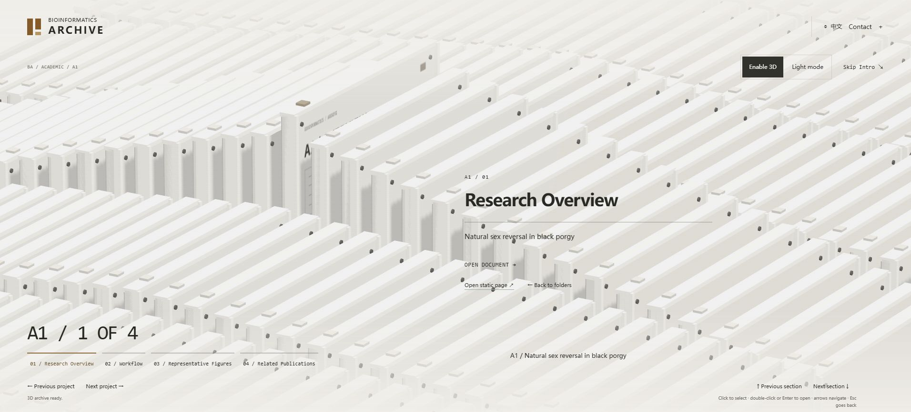

# Phase 3.1 — Hierarchical Archive Navigation Refactor

日期：2026-10-21。状态：本地实现与下述检查完成，未提交、推送或部署。

## 1. 本轮结果与视觉调整

在已有 Astro / TypeScript / Three.js 首页上完成两级导航与内容阅读器，没有重新初始化站点。按用户后续反馈，将最初稀疏排列的第二级模型改为接近 RhineLabUI 构图的**密集立式卡匣阵列**，不再是普通三维卡片列表。

- 暖白卡匣、清晰厚度、边框、紧固件、索引标签与磨砂面板；独立个人品牌。
- 纵深密集排列、横向项目列、长焦斜俯视、选中档案周围的肩部起伏、活动档案抽取与镜头推进。
- 第二级使用全视口；左侧三维主体、右侧标题与操作、底部栏目索引和四向导航。首页文件夹层保留原有终端布局。
- 桌面 9×36、紧凑模式 5×24 的有限物理槽位循环映射实际内容，形成连续阵列。重复外观不代表额外科研成果。
- 没有复制上游游戏模型、品牌、贴图、声音或字体，没有加入重型景深 / 后处理。

“95% 以上相似”是用户期望的视觉目标，目前没有定义或测量客观相似度；不能把这一百分比视为已通过验收。最终美术效果请依据以下实际本地截图确认。参考站在线操作连接曾超时，构图依据上游源码及作者提供的截图研究，未声称完成上游真机性能复测。



[320px 中文阵列截图](qa/phase3-1/matrix-320px.jpg) 使用桌面 Edge 中真实 320px CSS 视口的 iframe，不是手机真机截图。

补充截图：[首页两个文件夹](qa/phase3-1/home-folders.jpg)、[内容阅读器](qa/phase3-1/document-reader.jpg)。320px 检查中 clientWidth 与 scrollWidth 均为 320，无横向溢出。

## 2. 内容层次与交互

首页仅有 `01 Academic Portfolio` 和 `02 Technical Portfolio` 两个三维文件夹。单击选中，鼠标双击 / Enter / OPEN FOLDER 打开；触屏支持两次点击和明确按钮。封面、背板、书脊、内页和标签均为程序几何。

| 作品集 | 横向项目列 | 纵向四份档案 |
| --- | --- | --- |
| Academic | A1 黑鲷自然性逆转、A2 鱼类 T2T、A3 鱼类 DNMT、A4 罗非鱼 eccDNA | Overview / Workflow / Figures / Related Publications |
| Technical | T1 LLM-RNAseq-Platform、T2 BIOINFORMATICS ARCHIVE | Overview / Architecture & Workflow / Screenshots 或 UI Gallery / Repository & Documentation 或 Development Log |

左右只改变项目列，上下只改变栏目，均首尾循环；切回项目恢复该项目上次栏目。两种作品集复用同一个 `MatrixField`、相机、输入与状态逻辑。

阅读器提取既有静态详情中对应栏目和证据说明，包含实际文字、已有技术流程图与截图。图片链接打开原图，外部文献链接可新标签打开。科研图片和正式论文仍待核验，阅读器显示真实空状态，没有为了填满档案而添加假图、假 DOI 或科研结论。Publications 不再是首页第三个文件夹；旧 `/publications/` 仍保留，并在 Academic 静态目录内提供链接。

Contact 面板整合 About、教育与研究兴趣、技术技能、Email、GitHub、学术 CV 和求职简历入口。已知 GitHub 使用原有真实地址；未提供的个人资料和文件明确待补充，Google Scholar 无真实地址时不显示。About / Contact / CV 原页面和旧 URL 均保留。

## 3. 数据、状态与 URL

`archive-manifest.ts` 在构建期读取原有公开内容集合，组织 `Portfolio → Project → Section → Content`。项目 ID 使用既有 `translationKey`，英中保持一致。每个 Section 包含稳定 ID、静态页面 `href` 和对应详情 `contentIds`；增加项目不需要复制场景代码。未发布和私有记录不进入清单。

`archive-model.ts` 管理互斥基础状态 `HOME → PORTFOLIO_MATRIX → DOCUMENT_VIEWER`，Contact 是保留基础状态的覆盖层。项目列索引与按 `portfolio/project` 保存的行记忆分开。Esc 依次关闭 Contact、阅读器、矩阵。

`bootstrap.ts` 协调输入、DOM、场景与 URL。选择使用 replaceState，进入 / 打开 / 返回使用 pushState；刷新、前进后退解析 hash。例：`/#archive/academic/black-porgy-sex-reversal/workflow/read`；中文为相同 hash 加 `/zh/`。非法 ID 安全回退，语言切换保留有效位置。静态链接仍是 SEO 与分享的主要地址。

文件夹打开过渡 360ms，档案打开 520ms；减少动态效果或轻量模式直接进入。过渡期间阻止重复打开和选择，Esc / Contact / 历史导航可取消。鼠标命中使用 Raycaster，物理循环副本映射回逻辑内容；触屏滚动位移和 pointercancel 不当作点击。

`reader.ts` 用 AbortController 读取同源静态页面，最多缓存六页，清除非正文脚本和事件属性，避免重复维护内容。关闭 / 切换取消过期读取；读取失败仍保留静态链接。原生 dialog 承担阅读器模态焦点和 Esc。

## 4. 资源与许可

3D 只由首页动态加载。当前布局拥有模型资源，切换布局释放旧资源；矩阵共享几何和材质，8 组 InstancedMesh 加活动档案。桌面使用 1536px PCF 阴影，粗指针关闭阴影。稳态停止 RAF，页面隐藏、离屏、阅读器和 Contact 打开时暂停；轻量模式、离页和失败路径清理上下文、事件、观察器、计时器与 GPU 资源。

小屏、粗指针、reduced-motion、save-data 默认轻量。无 WebGL 时二维导航仍可打开阅读器；无脚本时服务器生成的原生 details 目录提供全部 24 个栏目静态链接。Skip Intro 从矩阵回到可访问的静态目录，恢复背景正文的可交互状态。

参考：[RhineLabUI](https://github.com/LBEILC/RhineLabUI) / [参考站](https://rhine.lubeiluchen.cc/)，固定研究提交 `12cc5e4013acb9408f753ff71de6b8492299b7c8`。已阅读 `src/archive-loop.ts`、`src/scene.ts`、`src/data.ts`、`src/main.ts`、`content/archives.json`，并补读运动与视口实现。参考文件留在仓库外。

改编范围：循环映射、肩部曲线及相机构图，目标为 `matrix-layout.ts` / `MatrixField.ts`。完整 `Copyright (c) 2026 LBEILC` 与 MIT 文本已保留在 [许可证](../public/licenses/RhineLabUI-MIT.txt)，对应来源见 [THIRD_PARTY_NOTICES.md](../THIRD_PARTY_NOTICES.md)，Credits 页面也可访问。历史阶段“未复用代码”说明不适用于当前实现。

## 5. 验证结果

环境：Windows、本机 Edge、Node 24.20.0 / npm 11.19.0；本地构建产物，未使用线上部署结果。

| 检查 | 实际结果 |
| --- | --- |
| `npm run check` | 51 个文件，0 errors / 0 warnings / 0 hints |
| `npm test` | 23 项通过，0 失败；含轴向循环、项目记忆、状态层级、hash、物理循环映射、内容发布门禁、RAF 与资源清理 |
| `npm run build` | 成功生成 37 个静态页面；Vite 提示异步 Three.js chunk 超过 500kB，非构建失败 |
| `npm run check:site` | 37 页、1169 个内部链接与锚点通过；两语言 manifest、栏目目标、草稿排除、sitemap、Three.js 页面隔离与许可通过 |
| `npm run format:check` | 通过 |
| 本地浏览器自动回归 | `LIFECYCLE PASS`；完整输出见 [lifecycle.txt](qa/phase3-1/lifecycle.txt) |

构建产物 gzip：首页控制器 7057 B，内容页 JS 194 B，延迟 3D 139826 B，CSS 11301 B，最大 HTML 5930 B。仅为本次文件体积，不是网络性能或 FPS 实测。

浏览器回归覆盖：静止停帧、快速选择、五轮启用 / 释放且资源计数稳定、隐藏 / 恢复、模拟 context loss 与重建、Academic 四列和行循环、跨列记忆、Technical 共用阵列、阅读器真实内容与暂停、Esc 返回、矩阵及阴影资源回收、打开期间重复输入和 Esc 取消、触屏位移 / cancel / 双击事件。回到首页后资源恢复为 4 个 geometry / 3 个 texture / 1 个活动 context。有限轮计数稳定不等同于长期所有设备都无泄漏。

浏览器操作另确认：文件夹单击与双击、方向键 / Enter、阅读状态刷新及前进后退、Contact 内容、Skip Intro、320px 中文阵列与阅读器。无 WebGL 的 getContext=null 注入仍可打开科研正文；无脚本通过本地服务器移除 script 验证原生目录；reduced-motion 默认不请求 3D，主动启用后两帧进入稳态；慢模块加载取消后无 canvas / context。见 [fallback.txt](qa/phase3-1/fallback.txt)。最终新建生产预览页的 warn/error 日志为空；此前已修复 Three.js PCFSoftShadowMap 弃用提示。

## 6. 仍需人工验收 / 资料

- 最终构图、材质、镜头运动是否达到用户要求的参考相似程度；未提供“95%”量化认证。
- iOS Safari / Android 真机双击与滚动、Firefox、屏幕阅读器、200% 缩放、低端 GPU 长时间运行及帧率测试。本轮窄屏 iframe 和合成触摸事件不能替代这些检查。
- 科研论文标题 / 作者 / DOI / 发表状态及可公开 PDF，实验设计、个人贡献和获准公开的科研图片；没有核验前不填入结果。
- 姓名与教育经历、研究兴趣、技能、邮箱、Scholar 地址、学术 CV 和求职简历；详见 [CONTENT_TODO.md](CONTENT_TODO.md)。

## 7. 修改文件清单

开始前 Git 全部为未跟踪文件，不能用普通 git diff 代表本轮改动。已在仓库外保存修改前 ZIP，并通过 SHA-256 对比以下已有文件；未删除基线文件。科研内容、论文集合、LLM 案例正文及既有科研 / 技术详情组件与备份一致。没有修改依赖清单或锁文件，没有修改 LLM-RNAseq-Platform 原仓库，保留用户 `test` 文件。

| 范围 | 新增 | 修改 |
| --- | --- | --- |
| 数据与状态 | `src/lib/archive-manifest.ts`、`src/lib/archive-model.ts` | `src/data/archive.ts`、`src/data/profile.ts`、`src/i18n/ui.ts` |
| Three.js 与阅读器 | `src/scene/MatrixField.ts`、`src/scene/matrix-layout.ts`、`src/scene/reader.ts` | `src/scene/ArchiveScene.ts`、`src/scene/bootstrap.ts`、`src/scene/types.ts` |
| 页面组件与样式 | `src/components/site/ContactPanel.astro`、`src/styles/hierarchy.css`、`src/styles/matrix.css` | `src/components/archive/ArchiveTerminal.astro`、`src/components/site/Header.astro`、`src/components/views/Home.astro`、`src/components/views/InfoPage.astro` |
| 网站自身案例 | — | `src/content/software/bioinformatics-archive/en.md`、`zh.md`；历史开发截图仍标记原阶段 |
| 检查 | `tests/archive-navigation.test.mjs`、`tests/matrix-layout.test.mjs` | `tests/browser/harness.js`、`scripts/check-site.mjs`、`scripts/preview-qa.mjs` |
| 规范与说明 | 本报告、`docs/qa/phase3-1/` 截图和日志、`public/licenses/RhineLabUI-MIT.txt` | `AGENTS.md`、`README.md`、`THIRD_PARTY_NOTICES.md`、`docs/ARCHITECTURE.md`、`docs/DESIGN_SPEC.md`、`docs/IMPLEMENTATION_PLAN.md`、`docs/CONTENT_PLAN.md`、`docs/CONTENT_TODO.md` |

## 8. 本地预览与复查

```powershell
$env:Path = "C:\Program Files\nodejs;" + $env:Path
npm.cmd run dev
```

打开命令输出地址（通常 `http://127.0.0.1:4321/`），双击 Academic 进入第二级。也可直接打开 `/#archive/academic/black-porgy-sex-reversal/overview`。中文加 `/zh/`。构建预览为 `npm.cmd run build` 后 `npm.cmd run preview`。

本地故障注入：构建后运行 `node scripts/preview-qa.mjs`，打开 `http://127.0.0.1:4323/?qa=normal` 并点 Run lifecycle checks。`qa=nogl/reduced/slow/storage/nojs` 是不同测试路径；脚本不进入 dist。检查结束 Ctrl+C 停止。未经用户确认不推送和部署。
